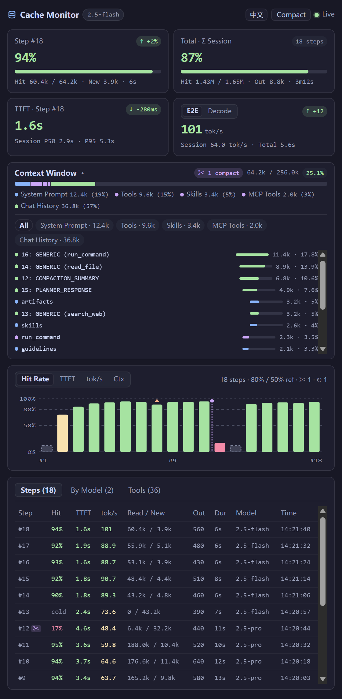
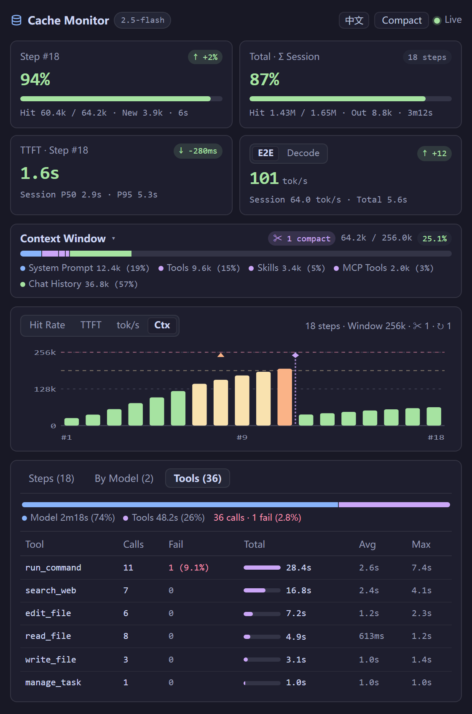
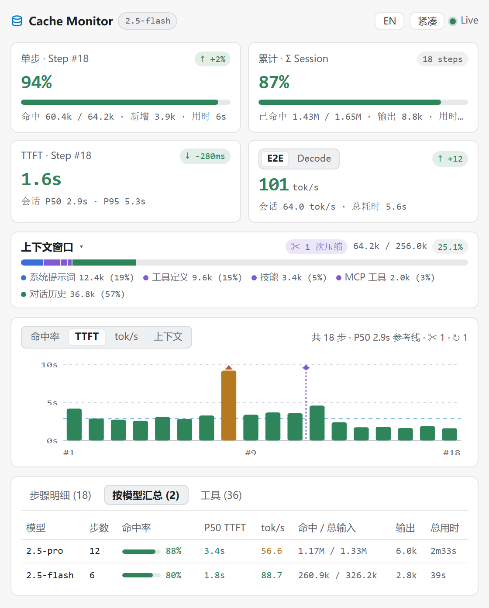
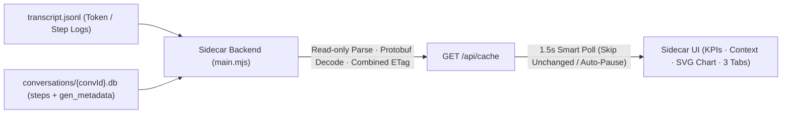

<div align="center">
  
  <h1>Cache Monitor</h1>
  <p><strong>Real-time prompt cache, context window, tool latency &amp; inference monitor for the Antigravity App side panel</strong></p>
  <p>Prompt cache hit rate · Millisecond TTFT · E2E / Decode tok/s · Context breakdown · Tool analytics</p>
  <p>
    <a href="./CHANGELOG.md"></a>
    
    = 22.5" />
    
    <a href="./LICENSE"></a>
  </p>
  <p>
    <strong>English</strong> · <a href="./README.zh-CN.md">简体中文</a>
  </p>
  <p>
    <a href="#screenshots">Screenshots</a> ·
    <a href="#features">Features</a> ·
    <a href="#quick-start">Quick Start</a> ·
    <a href="#core-metrics">Core Metrics</a> ·
    <a href="#ui-overview">UI Overview</a> ·
    <a href="#architecture">Architecture</a> ·
    <a href="#faq">FAQ</a>
  </p>
</div>

---

## Screenshots

<table>
  <tr>
    <td width="33%" valign="top" align="center">
      <strong>Dark Theme · Overview &amp; Context Breakdown</strong><br />
      <br />
      <sub>2×2 KPIs, expanded token breakdown, Hit Rate chart with <code>✂</code> / <code>↻</code> markers &amp; Steps table</sub>
    </td>
    <td width="33%" valign="top" align="center">
      <strong>Context Trend (<code>Ctx</code>) &amp; Tool Analytics</strong><br />
      <br />
      <sub>Context growth &amp; compaction cliff + Model vs. Tools wall-time split &amp; per-tool latency</sub>
    </td>
    <td width="33%" valign="top" align="center">
      <strong>Light Theme · Chinese UI &amp; Model Summary</strong><br />
      <br />
      <sub>Auto light-theme sync, one-click <code>中文 / EN</code> switch, TTFT trend &amp; By Model table</sub>
    </td>
  </tr>
</table>

## Features

<table>
  <tr>
    <td width="50%" valign="top">
      <strong>Dual-Scope Cache Insights</strong><br />
      Live per-step (<code>Step</code>) and cumulative (<code>Σ Session</code>) prompt cache hit rates with step-over-step deltas; per-model cold-start detection prevents false <code>⚠ Miss</code> alerts.
    </td>
    <td width="50%" valign="top">
      <strong>Millisecond TTFT</strong><br />
      Reads nanosecond timestamps from the read-only SQLite WAL database to display latest step TTFT, step delta, and session <code>P50 / P95</code> (hover for mean) resistant to long-tail spikes.
    </td>
  </tr>
  <tr>
    <td width="50%" valign="top">
      <strong>E2E / Decode Throughput</strong><br />
      Defaults to <code>E2E tok/s</code> for true end-to-end perceived speed; one-click switch to pure <code>Decode tok/s</code> with <code>&lt; 500ms</code> single-packet <code>burst</code> protection, persisted automatically.
    </td>
    <td width="50%" valign="top">
      <strong>Interactive 4-Metric Trend Chart</strong><br />
      Inline SVG chart switching between Hit Rate, TTFT, tok/s, and Context Usage (auto-focusing the latest 48 steps), annotated with <code>✂</code> compaction &amp; <code>↻</code> API retry markers and rich tooltips.
    </td>
  </tr>
  <tr>
    <td width="50%" valign="top">
      <strong>Context Window &amp; Breakdown</strong><br />
      Tracks live context usage vs. model window limit with a stacked category bar (<code>System Prompt</code>, <code>Tools</code>, <code>Chat History</code>, etc.) and collapsible top-item token breakdown.
    </td>
    <td width="50%" valign="top">
      <strong>Tool Latency &amp; Failure Analytics</strong><br />
      Parses nanosecond tool execution steps to show a deduplicated wall-clock <code>Model vs. Tools</code> split alongside per-tool call counts, failure rates, and <code>Total / Avg / Max</code> timings.
    </td>
  </tr>
  <tr>
    <td width="50%" valign="top">
      <strong>Zero Dependencies · Ultra-Low Overhead</strong><br />
      Powered by Node.js built-in <code>node:sqlite</code> and a zero-dependency Protobuf Wire decoder; skips multi-MB prompt blobs, uses WAL-aware combined ETag, and auto-pauses when hidden.
    </td>
    <td width="50%" valign="top">
      <strong>Native Light &amp; Dark Theme Sync</strong><br />
      Watches host <code>--background</code> luminance automatically, with compact mode and right-sidebar <code>Pin Tab</code> support that follows active conversations.
    </td>
  </tr>
</table>

## Quick Start

### Prerequisites

| Requirement | Details |
| :--- | :--- |
| **Antigravity App** | Desktop host application (with Sidecar auxiliary pane plugin support) |
| **Node.js `>= 22.5`** | Provides built-in `node:sqlite` for read-only DB parsing with zero external npm dependencies |

> [!NOTE]
> If the runtime lacks `node:sqlite` or opens a legacy conversation without a `.db` file, the monitor gracefully degrades to cache-hit-rate-only mode with zero configuration.

### Clone into the Plugins Directory

**macOS / Linux:**
```bash
git clone https://github.com/sjmdsky/antigravity-cache-monitor.git ~/.gemini/config/plugins/cache-monitor
```

**Windows (PowerShell):**
```powershell
git clone https://github.com/sjmdsky/antigravity-cache-monitor.git "$HOME\.gemini\config\plugins\cache-monitor"
```

### Enable and Pin

1. Confirm **Cache Monitor** is enabled under **Customizations / Plugins** in Antigravity App.
2. Open it from **Overview → Extensions → Cache Monitor** in the top-right corner of a conversation, or click **+** in the right sidebar and select **Cache Monitor**.
3. Right-click the tab and choose **Pin Tab** to keep it docked in the right sidebar—it automatically follows whichever conversation is active.

> [!TIP]
> To update later, run `git pull` inside the plugin directory, then disable and re-enable **Cache Monitor** under **Customizations / Plugins** to reload the Sidecar.

## Core Metrics

### Metric Definitions

| Metric | Formula / Data Source | Display & Aggregation |
| :--- | :--- | :--- |
| **Step Hit Rate (`Step`)** | `cache_read_tokens / (input_tokens + cache_read_tokens + cache_creation_tokens)` | Displays the latest model call's cache hit rate and delta vs. the previous step |
| **Session Hit Rate (`Σ Session`)** | Cumulative `cache_read_tokens` ratio across all `PLANNER_RESPONSE` steps | Shows overall prompt cache reuse efficiency and total step count for the session |
| **TTFT (Time to First Token)** | `first_token_at - created_at` (nanosecond timestamps from `conversations/<convId>.db`, millisecond precision) | Headline shows latest TTFT and step delta; subtext shows session **P50 / P95** (hover for mean) |
| **E2E tok/s (Default)** | `output_tokens / (completed_at - created_at)` (includes TTFT in denominator; total duration `≥ 100ms`) | Reflects true end-to-end perceived throughput; switchable across cards, chart, and tables |
| **Decode tok/s** | `output_tokens / (completed_at - first_token_at)` (pure streaming decode speed; stream duration `≥ 500ms`) | Measures pure token generation speed after first token; short packets are flagged `burst` |
| **Context Window** | `gen_metadata.f1.f9.f10` (`contextTokens / contextLimit` + latest `breakdown`) | Tracks live context utilization, compaction count (`✂`), and per-category / per-item token breakdown |
| **Tool Execution** | `steps` (`step_type = 132` timestamps, `status`, `error_details`) | Aggregates per-tool calls, failure rate (`status = 4/7`), `Total / Avg / P50 / Max`, and deduplicated wall time |

### Color Tiers

| Metric | 🟢 Good | 🟡 Fair | 🟠 Low / Slow | 🔴 Alert | ⚪ Special |
| :--- | :--- | :--- | :--- | :--- | :--- |
| **Cache Hit Rate** | `≥ 80%` | `50% ~ 79%` | `20% ~ 49%` | `< 20%` | `cold` (cold start) |
| **TTFT** | `< 5s` | `5s ~ 10s` | `10s ~ 20s` | `≥ 20s` | `--` |
| **E2E tok/s** | `≥ 80` | `40 ~ 79` | `15 ~ 39` | `< 15` | `--` |
| **Decode tok/s** | `≥ 120` | `60 ~ 119` | `30 ~ 59` | `< 30` | `burst` (`< 500ms`) |
| **Context Usage** | `< 50%` | `50% ~ 74%` | `75% ~ 89%` | `≥ 90%` | `✂` (compacted) |

### Key Classification Rules

- **Per-Model Cold Start (`cold` vs `⚠ Miss`)**: The first occurrence of each model in a conversation with `cache_read_tokens == 0` is labeled `cold` (distinguishing **first-step cold start** from **model-switch cold start** in Plan/Execute or Orchestrator workflows) rather than raising a false `⚠ Miss`. A `⚠ Miss` alert only triggers if the same model subsequently drops back to `0%`.
- **Short-Packet `burst` Protection**: Under `Decode` mode, single-packet or ultra-short responses with streaming duration `< 500ms` are marked `burst` (gray) and excluded from weighted averages to avoid artificial speed spikes.
- **Weighted Average Aggregation**: Both session and per-model `tok/s` use weighted averages (`total valid output tokens ÷ total valid duration`) so short turns do not skew overall throughput. Switching between `E2E` and `Decode` persists in `localStorage` and synchronizes the KPI card, trend chart, and both detail tables.

## UI Overview

| UI Region | Capabilities & Interactions |
| :--- | :--- |
| **Top Bar** | Displays the active model pill, **Language (`中文 / EN`)** toggle button (English by default, one-click switch to Simplified Chinese), **Compact** toggle button (collapses the chart and detail tabs to keep only the 2×2 KPI cards), and `Live / Paused / Reconnecting` polling status. |
| **2×2 KPI Grid** | Top row tracks Step and Σ Session cache hit rates; bottom row tracks TTFT and the `E2E / Decode` tok/s switcher. |
| **Context Window Card** | Stacked progress bar (`System Prompt`, `Tools`, `Chat History`, etc.) with compaction badge and collapsible top-item breakdown filtered by category. |
| **4-Metric Trend Chart** | Switches between Hit Rate, TTFT, tok/s, and Ctx (auto-focusing the latest 48 steps), annotated with `✂` compaction and `↻` retry markers; hover tooltip adds context usage, compaction savings, and retry/interruption errors. |
| **Steps Table** | Reverse-chronological per-step breakdown: `Step \| Hit \| TTFT \| tok/s \| Read / New \| Out \| Dur \| Model \| Time`, with inline `✂` / `↻` tags. |
| **By Model Table** | Per-model summary table: `Model \| Steps \| Hit Rate \| P50 TTFT \| tok/s \| Hit / Total \| Out \| Time`. |
| **Tools Table** | Wall-clock `Model vs. Tools` time split bar plus per-tool analytics: `Tool \| Calls \| Fail \| Total \| Avg \| Max`. |

> Language preference, compact mode state, context breakdown expand state, active chart metric, and `E2E / Decode` speed mode are automatically persisted in `localStorage` across reloads and conversation switches.

## Architecture



- **Dual-Source Read-Only Collection**: Combines `<appData>/brain/<convId>/.system_generated/logs/transcript.jsonl` with read-only SQLite WAL `<appData>/conversations/<convId>.db` (`steps` with `step_type = 15` & `132`, plus `gen_metadata`), backed by a built-in zero-dependency Protobuf Wire decoder that skips large prompt blobs for millisecond-level parsing. Strictly read-only, strict CSP, zero external network requests.
- **WAL-Aware Combined ETag & Smart Polling**: Computes a combined ETag from the `mtime/size` of `transcript.jsonl + .db + .db-wal`. When unchanged, 1.5s frontend polls receive `unchanged: true` with zero re-rendering, and polling pauses automatically whenever the tab is hidden.

<details>
<summary>Project Structure</summary>

```text
cache-monitor/
├── plugin.json                  # Antigravity plugin metadata and icon config
├── assets/
│   ├── logo.svg                 # Plugin icon
│   └── screenshots/             # README showcase screenshots (dark / tools / light-zh)
├── sidecars/
│   └── cache_monitor/
│       ├── sidecar.json         # Sidecar process and AUX_PANE entrypoint config
│       ├── package.json         # ESM module manifest (zero external dependencies)
│       ├── main.mjs             # Read-only dual-source parser, Protobuf decoder & /api/cache
│       ├── index.html           # Strict-CSP dashboard markup
│       ├── app.js               # Polling, 2×2 KPIs, SVG trend chart & detail tables
│       └── styles.css           # Adaptive host light/dark theme & compact styles
├── CHANGELOG.md                 # Release history
└── LICENSE                      # MIT License
```

</details>

## FAQ

<details>
<summary>Why did the UI not update after pulling the latest changes?</summary>

Disable **Cache Monitor** and re-enable it under **Customizations / Plugins** in Antigravity App to reload the Sidecar backend process and static frontend assets.

</details>

<details>
<summary>Why do I only see cache hit rates without TTFT or tok/s?</summary>

Ensure your Node.js runtime is `>= 22.5` (which provides built-in `node:sqlite`) and that the active conversation has a `.db` file. Otherwise, the plugin gracefully degrades to cache-hit-rate-only monitoring.

</details>

<details>
<summary>Do I need to refresh when switching conversations or themes?</summary>

No. Once pinned via **Pin Tab** in the right sidebar, the panel automatically tracks the active conversation ID, and a `MutationObserver` continuously syncs light/dark colors from the host `--background` CSS variable.

</details>

## Changelog and License

- **Changelog**: See [CHANGELOG.md](./CHANGELOG.md) (latest release: `v1.3.0`)
- **License**: [MIT License](./LICENSE)
