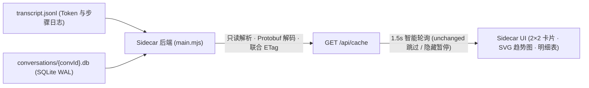

<div align="center">
  
  <h1>Cache Monitor</h1>
  <p><strong>Antigravity App 侧边栏实时提示词缓存与推理性能监控插件</strong></p>
  <p>实时追踪提示词缓存命中率 · 毫秒级 TTFT 首字延迟 · E2E / Decode 吞吐速率</p>
  <p>
    <a href="./CHANGELOG.md"></a>
    
    = 22.5" />
    
    <a href="./LICENSE"></a>
  </p>
  <p>
    <a href="./README.md">English</a> · <strong>简体中文</strong>
  </p>
  <p>
    <a href="#核心特性">核心特性</a> ·
    <a href="#快速开始">快速开始</a> ·
    <a href="#核心指标与色阶">核心指标与色阶</a> ·
    <a href="#视图与交互">视图与交互</a> ·
    <a href="#架构与原理">架构与原理</a> ·
    <a href="#常见问题">常见问题</a>
  </p>
</div>

---

## 核心特性

<table>
  <tr>
    <td width="50%" valign="top">
      <strong>双维度缓存洞察</strong><br />
      实时呈现单步 <code>Step</code> 与整场 <code>Σ Session</code> 提示词缓存命中率及步间涨跌；按模型智能区分冷启动与真实 <code>⚠ Miss</code>。
    </td>
    <td width="50%" valign="top">
      <strong>毫秒级 TTFT 首字延迟</strong><br />
      只读解析会话 SQLite WAL 纳秒时间戳，展示最新步延迟、步间差值及会话 <code>P50 / P95</code>（悬停查看均值），抵抗长尾排队失真。
    </td>
  </tr>
  <tr>
    <td width="50%" valign="top">
      <strong>E2E / Decode 双口径吞吐</strong><br />
      默认 <code>E2E tok/s</code> 反映端到端真实体感，一键切换纯解码 <code>Decode tok/s</code>（内置 <code>&lt; 500ms</code> 短包 <code>burst</code> 保护），状态自动持久化。
    </td>
    <td width="50%" valign="top">
      <strong>三指标交互趋势图</strong><br />
      内联 SVG 趋势图支持在 <code>命中率 / TTFT / tok/s</code> 间切换，超 48 步自动聚焦最近 48 步，悬停显示完整 Token 拆分与耗时细节。
    </td>
  </tr>
  <tr>
    <td width="50%" valign="top">
      <strong>零依赖 · 极低开销</strong><br />
      基于 Node.js 内置 <code>node:sqlite</code> 与内置轻量 Protobuf Wire 解码器，零外部 npm 依赖；WAL 感知 ETag + 后台不可见自动暂停轮询。
    </td>
    <td width="50%" valign="top">
      <strong>原生明暗外观融合</strong><br />
      自动监听宿主 <code>--background</code> 亮度同步明暗主题，支持紧凑模式与右侧边栏 <code>Pin Tab</code> 常驻，切换对话自动跟随。
    </td>
  </tr>
</table>

## 快速开始

### 环境要求

| 要求 | 说明 |
| :--- | :--- |
| **Antigravity App** | 桌面端宿主应用（支持 Sidecar 侧边栏插件扩展） |
| **Node.js `>= 22.5`** | 使用内置 `node:sqlite` 只读解析会话数据库，零外部 npm 依赖 |

> [!NOTE]
> 若运行时不支持 `node:sqlite` 或遇到旧版无 `.db` 的会话，将自动优雅降级为纯缓存命中率监控模式，无需任何额外配置。

### 克隆到插件目录

**macOS / Linux：**
```bash
git clone https://github.com/sjmdsky/antigravity-cache-monitor.git ~/.gemini/config/plugins/cache-monitor
```

**Windows (PowerShell)：**
```powershell
git clone https://github.com/sjmdsky/antigravity-cache-monitor.git "$HOME\.gemini\config\plugins\cache-monitor"
```

### 启用与固定

1. 在 Antigravity App 的 **Customizations / Plugins** 中确认启用 **Cache Monitor**。
2. 在对话右上角 **Overview → Extensions → Cache Monitor** 打开，或点击右侧边栏 **+** 选择 **Cache Monitor**。
3. 在标签页上右键选择 **Pin Tab** 即可常驻右侧边栏，切换对话时自动跟随当前会话。

> [!TIP]
> 更新插件代码后，在插件目录执行 `git pull`，并在 **Customizations / Plugins** 中关闭再重新开启 **Cache Monitor** 即可重载 Sidecar。

## 核心指标与色阶

### 指标口径

| 指标 | 计算方式 / 数据来源 | 展示与统计说明 |
| :--- | :--- | :--- |
| **单步命中率 (`Step`)** | `cache_read_tokens / (input_tokens + cache_read_tokens + cache_creation_tokens)` | 展示最近一次模型调用的命中率及与上一步的涨跌对比 |
| **累计命中率 (`Σ Session`)** | 整场会话所有 `PLANNER_RESPONSE` 步骤累计 `cache_read_tokens` 占比与总步数 | 反映整场对话的总体提示词缓存复用效率 |
| **TTFT（首字延迟）** | `first_token_at - created_at`（源自 `conversations/<convId>.db` 纳秒时间戳，毫秒精度） | 主值显示最新步 TTFT 与上一步差值，副文展示会话 **P50 / P95**（悬停显示均值） |
| **E2E tok/s（默认）** | `output_tokens / (completed_at - created_at)`（将 TTFT 计入分母，总耗时 `≥ 100ms`） | 反映单步端到端真实体感吞吐；卡片与明细均支持实时切换 |
| **Decode tok/s** | `output_tokens / (completed_at - first_token_at)`（纯解码吐字速率，流式时长 `≥ 500ms`） | 剔除首字等待后的纯生成速度，短包返回自动标记为 `burst` |

### 颜色分级一览

| 指标 | 🟢 优秀 | 🟡 良好 | 🟠 偏弱 | 🔴 告警 | ⚪ 特殊 |
| :--- | :--- | :--- | :--- | :--- | :--- |
| **缓存命中率** | `≥ 80%` | `50% ~ 79%` | `20% ~ 49%` | `< 20%` | `cold`（冷启动） |
| **TTFT** | `< 5s` | `5s ~ 10s` | `10s ~ 20s` | `≥ 20s` | `--` |
| **E2E tok/s** | `≥ 80` | `40 ~ 79` | `15 ~ 39` | `< 15` | `--` |
| **Decode tok/s** | `≥ 120` | `60 ~ 119` | `30 ~ 59` | `< 30` | `burst`（`< 500ms`） |

### 关键判定规则

- **按模型冷启动判定（`cold` vs `⚠ Miss`）**：每个模型在当前会话中首次出现且 `cache_read_tokens == 0` 时均标为 `cold`（区分**首步冷启动**与 Plan/Execute、Orchestrator 等**切模型冷启动**），不再误报为 `⚠ Miss`；仅当同一模型后续调用再次掉到 `0%` 时才触发 `⚠ Miss`。
- **短包 `burst` 保护**：Decode 口径下流式时长 `< 500ms` 的单包返回标为 `burst`（灰色）并从加权平均中排除，避免短包产生虚假速率尖峰。
- **加权平均口径**：会话与按模型汇总的 `tok/s` 均采用「有效步总输出 ÷ 有效步总耗时」，避免短步拉偏整体观感；速率卡片左上角切换 E2E / Decode 后持久化于 `localStorage`，并同步联动卡片、趋势图与双 Tab 明细表。

## 视图与交互

| UI 模块 | 功能与交互 |
| :--- | :--- |
| **顶栏控制区** | 展示当前活跃模型标签、**紧凑**模式切换按钮（折叠趋势图与明细，仅保留 2×2 四张核心卡片）及 `Live / Paused / Reconnecting` 轮询状态指示。 |
| **2×2 核心指标卡** | 上排展示单步与累计缓存命中率，下排展示 TTFT 与 `E2E / Decode` 速率切换。 |
| **三指标趋势图** | 支持在 `命中率 / TTFT / tok/s` 间切换（超 48 步自动聚焦最近 48 步）；悬停 Tooltip 同时展示命中率、TTFT、E2E 与 Decode tok/s、`思考 / 回复` Token 拆分及模型/工具耗时细节。 |
| **步骤明细（Tab 1）** | 按最新步倒序展示，列顺序为 `步 \| 命中 \| TTFT \| tok/s \| 读 / 新增 \| 输出 \| 用时 \| 模型 \| 时间`。 |
| **按模型汇总（Tab 2）** | 按模型聚合展示 `模型 \| 步数 \| 命中率 \| P50 TTFT \| tok/s \| 命中 / 总输入 \| 输出 \| 总用时`。 |

> 紧凑模式状态、当前选中的趋势图指标以及 `E2E / Decode` 速率口径均自动持久化于 `localStorage`，切换或重载后保留偏好。

## 架构与原理



- **双源只读采集**：结合 `<appData>/brain/<convId>/.system_generated/logs/transcript.jsonl` 与只读 SQLite WAL `<appData>/conversations/<convId>.db`（仅读取 `steps` 表 `step_type = 15` 的轻量 `metadata` Protobuf），内置零依赖 Protobuf Wire 解码器，同时补全纯文本结束步的精确耗时；严格只读、严格 CSP，无外部网络请求。
- **WAL 感知联合 ETag 与智能轮询**：基于 `transcript.jsonl + .db + .db-wal` 的联合 `mtime/size` 生成 ETag，无变化时前端 1.5 秒轮询直接返回 `unchanged: true`；页签隐藏时自动暂停轮询，开销极低。

<details>
<summary>项目结构</summary>

```text
cache-monitor/
├── plugin.json                  # Antigravity 插件元数据与图标配置
├── assets/
│   └── logo.svg                 # 插件图标
├── sidecars/
│   └── cache_monitor/
│       ├── sidecar.json         # Sidecar 进程与 AUX_PANE 入口配置
│       ├── package.json         # ESM 模块声明（零外部依赖）
│       ├── main.mjs             # 只读双源解析、Protobuf 解码与 /api/cache 服务
│       ├── index.html           # 严格 CSP 约束的监控面板骨架
│       ├── app.js               # 轮询调度、2×2 KPI、SVG 趋势图与双 Tab 明细渲染
│       └── styles.css           # 自适应宿主明暗主题与紧凑模式样式
├── CHANGELOG.md                 # 版本更新日志
└── LICENSE                      # MIT 开源协议
```

</details>

## 常见问题

<details>
<summary>拉取更新后插件界面未变化怎么办？</summary>

在 Antigravity App 的 **Customizations / Plugins** 中关闭 **Cache Monitor** 并重新开启一次，即可重载 Sidecar 后端服务与前端静态资源。

</details>

<details>
<summary>为何只显示缓存命中率，没有 TTFT 和 tok/s？</summary>

请确认运行环境的 Node.js 版本 `>= 22.5`（用于提供内置 `node:sqlite`），且当前打开的是包含 `.db` 会话数据库的对话；当运行时不支持 `node:sqlite` 或遇到旧版无 `.db` 的会话时，插件会自动优雅降级为纯缓存命中率监控。

</details>

<details>
<summary>切换对话或明暗主题后需要手动刷新吗？</summary>

无需手动刷新。将标签页右键 **Pin Tab** 常驻右侧边栏后，切换对话会自动跟随当前会话 ID 轮询；界面同时通过 `MutationObserver` 自动监听宿主 `--background` 亮度并同步明暗主题。

</details>

## 更新日志与开源协议

- **更新日志**：查看 [CHANGELOG.md](./CHANGELOG.md)（当前最新版本 `v1.1.0`）
- **开源协议**：[MIT License](./LICENSE)
